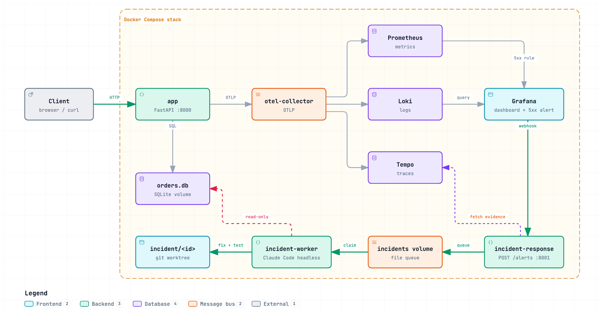

# Order Tracker

A small order tracking app for the AI Dev Tools Zoomcamp observability homework. It has a web page, an API, tests, a Docker Compose observability stack (OpenTelemetry, Prometheus, Loki, Tempo, Grafana), and an AI incident responder that reacts to Grafana alerts.

The main user flow is creating an order and checking its status. Three sample orders are created on first startup.

## How it works



Open [docs/architecture.html](docs/architecture.html) in a browser for the interactive version. Its source is [docs/architecture.json](docs/architecture.json).

1. The app sends OTLP metrics, logs, and traces to the Collector. The Collector exports metrics for Prometheus to scrape, logs to Loki, and traces to Tempo.
2. Grafana evaluates the **Order lookup 5xx responses** rule every minute. It fires after one minute of 5xx responses from the order lookup endpoint and posts to `incident-response` on port `8001`.
3. `incident-response` saves the alert payload, the affected endpoint, and the related Loki logs and Tempo traces. It marks firing alerts as `queued` and replies right away. It has no Claude credentials and no repository access.
4. `incident-worker` checks the queue every few seconds and claims one incident at a time. It runs Claude Code in headless restricted mode in an isolated `incident/<id>` Git worktree under `.incident-worktrees/`.

The agent can:

- inspect and edit repository files in its worktree
- run only the fixed command `uv run --frozen --group dev pytest -q`
- query the orders database through a read-only tool

The agent cannot commit, merge, run any other shell command, or change the database. If the data needs correcting, it writes the SQL to `incident-data-fix.sql` in the worktree but never runs it. A human reviews and applies every change.

Each incident's `assistant.state` moves from `queued` to `running` to `completed` or `failed`. The agent's report is saved in the incident record and in its `.assistant.log` file. A queued incident stays queued if the worker is stopped or has no token, and runs when the worker starts with a token.

## Run it

You need Docker with Compose. To run the tests, you also need Python 3.11+ and `uv`. Run `docker compose` from the repository root.

```bash
docker compose up --build -d --wait
```

| Service | URL |
| --- | --- |
| App | <http://127.0.0.1:8000> (API at `/api/orders`, health check at `/healthz`) |
| Grafana | <http://127.0.0.1:3000> (login `admin` / `admin`, **Order Tracker Requests** dashboard) |
| Incidents | <http://127.0.0.1:8001/incidents> (one incident at `/incidents/{incident_id}`) |

Order, observability, and incident data are stored in Docker volumes. Inspect Collector output with `docker compose logs otel-collector`.

### Enable the agent

1. On a trusted machine with a Claude subscription, run `npx --yes @anthropic-ai/claude-code setup-token`.
2. Put the result in the git-ignored `.env` file as `CLAUDE_CODE_OAUTH_TOKEN`. Never commit the token or paste it into chat.
3. Run `docker compose up -d incident-worker`.
4. Follow the worker with `docker compose logs -f incident-worker`.

## Try the incident loop

1. Trigger the failure. The sample order `express-1002` returns a 500:

   ```bash
   curl -i http://localhost:8000/api/orders/express-1002
   ```

2. Wait about two minutes. Grafana fires the alert, and a new incident appears at <http://127.0.0.1:8001/incidents>. Its `assistant` state changes from `queued` to `running` to `completed`.
3. Read the agent's report in the incident's `assistant.summary` field.
4. Review the proposed fix. The changes are uncommitted in the worktree:

   ```bash
   git -C .incident-worktrees/<incident_id> diff
   ```

5. Run the app from the fix and check the result:

   ```bash
   (cd .incident-worktrees/<incident_id> && docker compose up -d --build --no-deps --wait app)
   curl -i http://localhost:8000/api/orders/express-1002
   ```

6. Switch back to `main` with `docker compose up -d --build app` from the repository root.

To send a test alert without causing a failure:

```bash
curl -X POST http://localhost:8001/alerts \
  -H 'Content-Type: application/json' \
  -d '{"alerts":[{"status":"firing","labels":{"alertname":"ResponderTest","test":"true"},"annotations":{"summary":"Test notification; no incident to fix"}}]}'
```

To remove old fix worktrees and branches:

```bash
git worktree remove --force .incident-worktrees/<incident_id>
git branch -D incident/<incident_id>
```

## Configuration

| Variable | Default | Purpose |
| --- | --- | --- |
| `CLAUDE_CODE_OAUTH_TOKEN` | none | Enables the agent. Passed only to `incident-worker`. |
| `CLAUDE_CODE_MODEL` | `sonnet` | Model the agent uses. |
| `INCIDENT_ASSISTANT_ENABLED` | `true` | Set to `false` to save alerts without queuing them. |
| `ORDER_TRACKER_PORT` | `8000` | App port on the host. |
| `GRAFANA_PORT` | `3000` | Grafana port on the host. |
| `GRAFANA_ADMIN_PASSWORD` | `admin` | Local Grafana password. |

For example, if ports 8000 and 3000 are in use:

```bash
ORDER_TRACKER_PORT=18080 GRAFANA_PORT=13000 docker compose up --build -d --wait
```

## Tests

```bash
uv run --frozen pytest -q
```

Stop the stack with `docker compose down`. Add `-v` only if you also want to delete the order, observability, and incident data.

## API

| Method | Path | Purpose |
| --- | --- | --- |
| GET | `/` | Web page |
| GET | `/healthz` | Database health check |
| GET | `/api/orders` | List orders |
| POST | `/api/orders` | Create an order |
| GET | `/api/orders/{id}` | Check an order |
| PATCH | `/api/orders/{id}` | Change an order status |

The app uses SQLite to keep setup small. Run one app container at a time.

## Design choices

- **Two services instead of one.** The receiver replies to Grafana immediately, and a failed or slow agent run cannot lose an alert. Only the worker holds the Claude token, and the worker exposes no port.
- **A file-based queue.** Incidents and claim files on a shared volume are durable on one host and safe with more than one worker. At a few alerts per hour, Kafka or Airflow would add infrastructure without solving a real problem.
- **Proposal, not deployment.** The agent leaves its fix on a branch. A wrong diagnosis costs a branch, not an outage.

## Areas for improvement

This project is a working MVP. It proves the full loop, from alert to evidence to diagnosis to tested fix, on one planted bug. These gaps remain.

| Gap | Why it matters |
| --- | --- |
| No one watches the responder | The receiver and worker emit no metrics or traces. Failed runs or a growing queue raise no alert. |
| No deduplication | Each time Grafana repeats a firing alert, it creates a new incident, a new agent run, and a new branch. This wastes quota and clutters the repository. |
| No one is told | Nothing notifies a developer when a fix is ready or when the agent cannot find a cause. The fix waits silently in a worktree. |
| Weak links between signals | Evidence is gathered by endpoint and time window, not by trace ID. In the test, the agent could not confirm which order ID failed. |
| Basic alerting | There is one rule with a threshold of more than 0 errors. There are no latency, saturation, or SLO burn-rate alerts. |
| No check that the fix worked | Nothing confirms that the alert resolves after a fix is deployed. Recovery time still depends on a human merging and deploying. |
| Untrusted input reaches the agent | Logs and alert text go into the prompt. Tool limits and instructions reduce the risk of prompt injection but do not remove it. |
| Single-host setup | The file queue, SQLite, and the default Grafana login suit a laptop, not production. |
| Tested on one bug | The only real incident so far was a one-line code fault with a clear stack trace. Real incidents are often in config, infrastructure, dependencies, or data. |

### Next steps

1. **Deduplicate by alert fingerprint**, so one ongoing problem gets one incident and one agent run.
2. **Instrument the worker** and add alerts for failed runs and queue backlog.
3. **Notify a human** with the diagnosis and diff, or open a pull request, when a run finishes.
4. **Correlate by trace ID.** Add `trace_id` to logs, `order_id` to spans, and exemplars to metrics.
5. **Add SLO burn-rate and latency alerts.**
6. **Verify after deploy** that the alert resolves, and record the result on the incident.
7. **Evaluate the agent** on 10 to 20 planted faults of different kinds, such as a bad config value, a slow query, a missing environment variable, bad data, and a dependency error. Record correct diagnoses, correct fixes, harmful changes, time, and token cost. The results decide whether to invest in automated pull requests and deployment, or to position the agent as a triage assistant.
8. **Move the queue to Postgres** (`SELECT ... FOR UPDATE SKIP LOCKED`) if the responder needs more than one host. Consider Temporal if the workflow grows to include approval, deployment, and verification steps.
